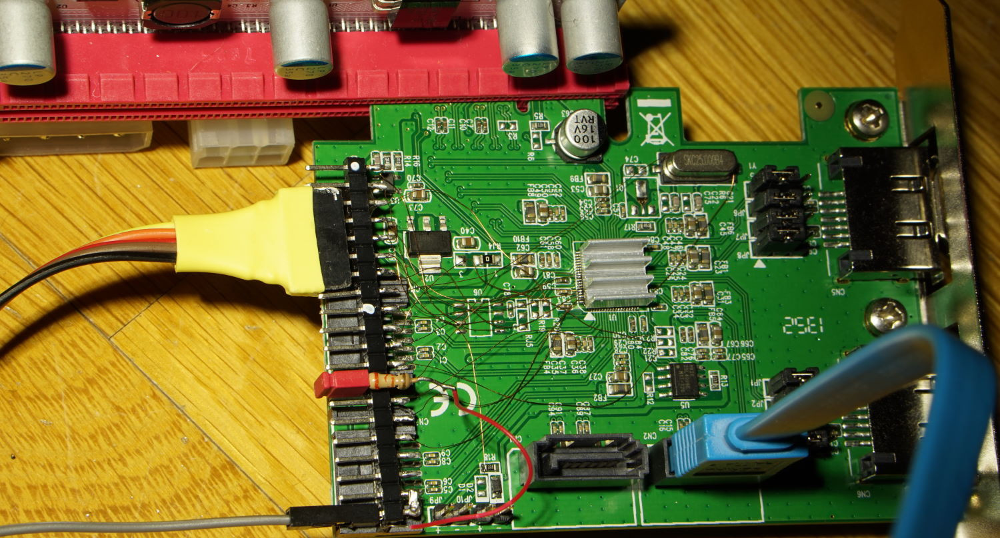

# pcileech-marvell-9230



Turn a Marvell 88SE9230 SATA controller into a pcileech-compatible physical
memory acquisition device. The controller keeps working as an ordinary AHCI
disk controller; a CH568 USB bridge on a reserved SATA port streams host
memory to the analyst machine at up to 25 MiB/s. No software or drivers are
loaded on the target.

credits: [15432](https://habr.com/ru/articles/532672/)

Yes, this is AI slop. Don't care — hope it helps. Stop torturing Xilinx.

## How it works

```
MemProcFS / pcileech (analyst PC)
        |
  leechcore_device_rawtcp protocol
        |
  host-tools/ch568_leechbridge.py      (address map + LeechCore TCP bridge)
        |
  USB mailbox  ->  CH568 firmware      (SATA peer, zero-copy streaming)
        |
  SATA link     ->  88SE9230 firmware  (PCIe DMA via host-address PRDT)
        |
  target physical memory
```

The 9230 firmware validates every read against a host-supplied physical
memory map before arming the DMA engine, so unmapped addresses are rejected
instead of wedging the controller.

## Repository layout

- `marvell9230/` - open firmware for the 88SE9230, build tools, ARM emulator
  test suite (Python, Unicorn). Build requires your own stock SPI dump as
  template: `python tools/build_c_stage.py --template <dump.bin> --output
  build/image.bin --basic-boot-probe --no-option-rom --ch568-diagnostics`
- `ch568/` - CH568 SATA mailbox firmware sources and Windows build script
  (NDS32 toolchain required)
- `host-tools/` - LeechCore bridge, memory-map discovery, test clients
- `binaries/` - prebuilt images for both chips

## Hardware

- 88SE9230 PCIe SATA card (any common 4-port card), SPI flash programmer
- CH568 USB/SATA bridge board on SATA port 2
- USB connection from the CH568 to the analyst PC; nothing else connects
  the two machines

## Usage

```
py host-tools/ch568_leechbridge.py
MemProcFS.exe -device "rawtcp://127.0.0.1:8888"
```

Processes, virtual memory, registry and the forensic VFS mount
automatically. `host-tools/test_memory_read.py <physical-address>` reads a
single 4 KiB page; `host-tools/read_memory_batch.py --linear --pages 128
--no-crc` benchmarks sustained throughput.

## License

MIT for all code in this repository. The vendor SPI dump used as build
template is not part of this repository and must be obtained from your own
hardware.
